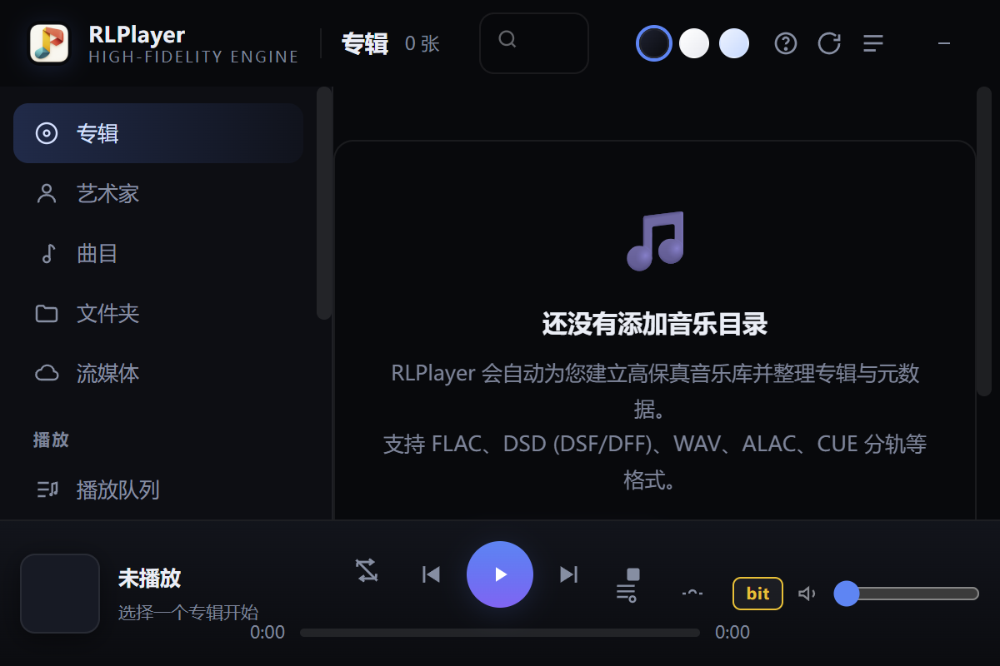

# RLPlayer2 审查修复与验收记录

基线：`c9b113ac44f23c820692a80fe3aeff088fa2c954`。本次交付是源码修复分支；没有发布 Windows 安装包或修改上游仓库。Fork：<https://github.com/steinfigur/RLPlayer2>。

## 修复边界与原先容易踩的坑

- 每项先核对实际生产调用链；旧报告的候选不自动当成事实。测试链接正式实现，平台/传输替身仅用于隔离设备和网络。
- 重点检查请求参数、实际执行、持久化状态和对外结果是否一致。测试通过不代表真实设备已验证，marker合法也不代表调制的音频正确。
- EOF保持原有源时长合同：补回算法延迟中尚未输出的源内容，不擅自延长额外混响尾。停止/取消不执行正常EOF排空。
- AHM保留多电平算法；当前没有经验证的同速率1-bit出口，因此明确拒绝AHM+DSD播放组合，不声称实现了新转换能力。
- 同一源码由一名写者负责；音频、数据、Web/更新由三个 `gpt-6.1-sol` 子代理分工，主控复核跨模块参数与生命周期并集成，后续另做独立接线复核。

## 两轮清单的逐项处理

| ID | 修改与验收重点 | 正式位置 |
|---|---|---|
| F01 | 起播目标增益和逐帧多声道渐变 | [`src/dsp/volume.h`](../src/dsp/volume.h), [`src/engine/pipeline.h`](../src/engine/pipeline.h) |
| F02 | DFF声道交错读写、流式末块 | [`src/audio/dsd_reader.h`](../src/audio/dsd_reader.h), [`src/audio/audio_loader.h`](../src/audio/audio_loader.h) |
| F03 | AHM多电平与1-bit输出能力契约；API/CLI前置拒绝 | [`src/dsp/modulator.h`](../src/dsp/modulator.h), [`tools/rtaweb.cpp`](../tools/rtaweb.cpp), [`tools/rtaplay.cpp`](../tools/rtaplay.cpp) |
| F04 | DoP载波不经PCM音量；起播和播放中能力门禁 | [`src/audio/render_loop.h`](../src/audio/render_loop.h), [`src/audio/wasapi_out.h`](../src/audio/wasapi_out.h), [`tools/rtaweb.cpp`](../tools/rtaweb.cpp) |
| F05 | 播放命令与队列修改串行；参数快照；退出顺序 | [`tools/rtaweb.cpp`](../tools/rtaweb.cpp) |
| F06 | 受管HTTP worker、取消网络等待、停止后等待所有worker | [`src/net/webui.h`](../src/net/webui.h) |
| F07 | 逐文件写前台账、旧文件hash、失败恢复、launcher失败状态传播 | [`src/net/update_apply.h`](../src/net/update_apply.h), [`tools/launcher.cpp`](../tools/launcher.cpp) |
| F08 | 完整清单、完成标记、hash身份、冻结下载输入和跨进程写者锁 | [`src/net/update.h`](../src/net/update.h), [`src/net/update_staging.h`](../src/net/update_staging.h), [`src/net/update_process.h`](../src/net/update_process.h) |
| F09 | 路由与方法门禁共用路径边界；补库播放/入队门禁 | [`src/net/request_values.h`](../src/net/request_values.h), [`tools/rtaweb.cpp`](../tools/rtaweb.cpp) |
| F10 | 远端配置/账号/对象完整身份与独立缓存对象 | [`src/net/source_mgr.h`](../src/net/source_mgr.h) |
| F11 | 源缓存/上传完整写入、关闭、原子发布后才成功 | [`src/net/cache_file.h`](../src/net/cache_file.h), [`tools/rtaweb.cpp`](../tools/rtaweb.cpp) |
| F12 | 扫描worker失败不发布部分索引，先持久化再切内存 | [`src/net/library.h`](../src/net/library.h) |
| F13 | 按结构化键语义递归脱敏及最终发送体验证 | [`src/net/feedback_redaction.h`](../src/net/feedback_redaction.h), [`src/net/feedback.h`](../src/net/feedback.h) |
| F14 | 语言/实体路径约束和缓存根边界 | [`src/meta/retrieval.h`](../src/meta/retrieval.h), [`src/meta/knowledge.h`](../src/meta/knowledge.h) |
| F15 | 同名上传独立对象目录，保原展示名和旧引用 | [`src/net/cache_file.h`](../src/net/cache_file.h), [`tools/rtaweb.cpp`](../tools/rtaweb.cpp) |
| F16 | 截断DSF明确失败，不以DSD零补数据冒充完整 | [`src/audio/audio_loader.h`](../src/audio/audio_loader.h) |
| F17 | 移除公共算法延迟，正常EOF排空到源时长；起始零帧与CLI接线 | [`src/engine/pipeline.h`](../src/engine/pipeline.h), [`tools/rtaweb.cpp`](../tools/rtaweb.cpp), [`tools/rtaplay.cpp`](../tools/rtaplay.cpp) |
| F18 | DoP合法尾帧、部分写入一次补齐、DirectSDM末位保留 | [`src/audio/render_loop.h`](../src/audio/render_loop.h), [`tools/rtaweb.cpp`](../tools/rtaweb.cpp), [`tools/rtaplay.cpp`](../tools/rtaplay.cpp) |
| F19 | seek epoch和目标原子领取、清残样、预热、设备边界marker、EOF后可再seek | [`src/audio/render_loop.h`](../src/audio/render_loop.h), [`tools/rtaweb.cpp`](../tools/rtaweb.cpp) |
| F20 | PEQ跨曲/seek历史复位与旁路过渡 | [`src/dsp/peq.h`](../src/dsp/peq.h), [`src/engine/pipeline.h`](../src/engine/pipeline.h) |
| F21 | ISP真实执行及统一完整性结果，真实位深/容器位深区分 | [`src/engine/pipeline.h`](../src/engine/pipeline.h), [`src/engine/playback_integrity.h`](../src/engine/playback_integrity.h), [`tools/rtaweb.cpp`](../tools/rtaweb.cpp) |
| F22 | GUI/CLI复用完整滤波器预设映射，传递apod参数 | [`src/engine/pipeline.h`](../src/engine/pipeline.h), [`tools/rtaweb.cpp`](../tools/rtaweb.cpp), [`tools/rtaplay.cpp`](../tools/rtaplay.cpp) |
| F23 | 默认/预设/显式覆盖次序；CLI显式taps/volume不被配置覆盖 | [`tools/rtaweb.cpp`](../tools/rtaweb.cpp), [`tools/rtaplay.cpp`](../tools/rtaplay.cpp) |
| F24 | ASIO PCM实时增益、0dB逐位保留及DoP/Native保护 | [`src/audio/asio_out.h`](../src/audio/asio_out.h), [`src/audio/pcm_gain.h`](../src/audio/pcm_gain.h), [`tools/rtaweb.cpp`](../tools/rtaweb.cpp) |
| F25 | 请求拥有响应状态；并发/嵌套/异常互不串状态码 | [`src/net/webui.h`](../src/net/webui.h) |
| F26 | 扫描进度限频时间戳同步 | [`src/net/library.h`](../src/net/library.h) |
| F27 | 非幂等POST响应丢失后不自动重放 | [`src/net/ui_script.h`](../src/net/ui_script.h) |
| F28 | 严格JSON完整语法、尾部消费、错误状态与深度边界 | [`src/net/json.h`](../src/net/json.h) |
| F29 | UTF-16代理对转正确UTF-8；拒绝非法代理/原始编码 | [`src/net/json.h`](../src/net/json.h) |
| F30 | Knowledge正负缓存包含语言身份 | [`src/meta/knowledge.h`](../src/meta/knowledge.h) |
| F31 | 语义最低版本5，旧v4不作为有效资料回退 | [`src/meta/retrieval.h`](../src/meta/retrieval.h) |
| F32 | HealthStore完整schema往返，CLI JSON输出/失败退出码 | [`src/analysis/health_store.h`](../src/analysis/health_store.h), [`tools/rtahealth.cpp`](../tools/rtahealth.cpp) |
| F33 | CLI WebUi所有者覆盖播放会话和回调状态寿命 | [`tools/rtaplay.cpp`](../tools/rtaplay.cpp) |
| F34 | 严格有限数值/整数边界，覆盖音量、PEQ、CUE、settings、cast | [`src/net/request_values.h`](../src/net/request_values.h), [`src/net/request_numeric.h`](../src/net/request_numeric.h), [`tools/rtaweb.cpp`](../tools/rtaweb.cpp) |
| F35 | 配置/构建各自按实际退出码失败；不用旧二进制假通过 | [`tools/verification_gates.ps1`](../tools/verification_gates.ps1), [`verify.ps1`](../verify.ps1) |
| F36 | 拒绝零测试/意外全跳过，读取JUnit计数，保留详细输出 | [`tools/verification_gates.ps1`](../tools/verification_gates.ps1), [`.github/workflows/ci.yml`](../.github/workflows/ci.yml) |

| 条目 | 处理 |
|---|---|
| M01 | 打包默认版本从 `src/version.h` 读取，显式版本不一致失败。没有改版本号或发布 release。 |
| M02 | 删除当前工具说明中过期的 NAA 工具清单，保留 RTANet 说明。 |
| C01 | WAV整曲/流式统一拒绝不受支持的float位深和坏格式，实际头文件反例覆盖。 |
| C02 | 补 `cstdint` 直接依赖，独立头文件TU在GCC/MSVC通过。 |
| C03 | 保留旧 `gpu` 兼容字段以及 `ramp=0` 表示默认的语义；不凭无消费者就删除公共字段。 |

## 深入复核新增修复

- 曲库/实体/HealthStore固定临时文件和写盘失败的同类问题收敛到checked writer；不删除旧正身来伪装替换成功。
- 曲库用revision检查阻止旧扫描覆盖期间发生的手动删除/清理。确定不存在与暂时不可访问分开，后者保留记录。
- 更新不仅检查文件数，还绑定完整清单/摘要；下载输入按启动时快照冻结。OS写者锁与运行期共享/替换期独占lease分工；旧版无lease的同安装进程另做只读检查。
- 回滚需要旧文件摘要证明，备份丢失或恢复失败不能称“已回滚”。launcher按持久phase决定是否能启动，保留恢复材料。
- DFF/DSF抽取最后不足一个抽取周期的帧计数统一；流式只读取有效位。ASIO欠载发送平衡DSD静音，PCM整数转换0dB保持逐位。
- 生产者首块失败的join不再持有其退出需要的队列锁；生产者到EOF后等待seek/abort，避免短曲seek失去供数者。
- 未知或已移除的backend在参数入口明确拒绝，避免默认回退到真实WASAPI端点；增加`naa`和任意未知值负测。
- `verify.ps1`使用动态端口、GUID隔离目录、监听PID归属检查和正常退出；旧NAA正测替换为当前不支持后端的拒绝验收，保留RTANet与DirectSDM原门禁。
- JSON大finite数转字符串与反馈序列化避免long long越界转换，保留足够精度。`rtahealth --json` stdout保持单行JSON，缓存保存失败明确非0退出。

## 平台边界门禁补齐

原始提交使用同一官方扫描器已有119处违规，首个修复提交为133处。本轮将更新原生锁/文件/进程、反馈主机观察/单次HTTP、文本转换和环境读取移入`src/platform/`纯接口与`windows/`实现；业务仍留net/meta，曲库复用既有文件接口。完整扫描最终**违规0、退出0**，原3条socket白名单及扫描器均未修改。新增98项编码/环境回归保留坏UTF8替换、嵌入NUL、GBK降级、63/64长度边界和各开关的空白差异。接口说明同步到[`PLATFORM.md`](../PLATFORM.md)。

## 完整门禁暴露的旧测试问题

原基线在同一Clang23 Release环境下EC-7@DSD512矩形窗SNR约103.5dB，低于原105dB门槛。本次没有改调制器数值体或放宽门槛：独立直接DFT、已知两音/白噪声与多相位验证证实强带外量化噪声的有限矩形窗边界泄漏。测试改用能量归一化周期Hann窗；0.5基波与1e-4带内污染得到73.9794dB，仍必须失败105dB，白噪声功率校准误差约0.121dB。过载/恢复/限幅判据保留。

格式矩阵原手写DFF夹具仍按左右声道平面存储，CMPR名称长度也不合法。按标准修正夹具，保留原电平门槛；新增DSF/DFF同源有效位、PCM逐样本相等，以及官方精简FFmpeg独立提取字节核验，38项通过。

严格JSON也揭出了原正向fixture的缺括号、未转义换行/引号及把UTF-8码点拆进不同JSON event的问题。修正正向fixture并补拒绝反例，保留SSE传输按3/11字节切分的回归；没有放松生产解析器。

OPRA测试显式使用源码资源目录，支持仓库外构建。标签A/B测试改为FFmpeg真编码四格式各5份，保留完整20文件逐字段/±1帧断言与1000文件吞吐回归。200字符文件名测试使用独立短临时目录并检查夹具写入成功，避免把构建路径过长造成的“文件未创建”误报成分析器失败。

首轮远端CI正式构建成功，116个CTest只有`health_robust`失败：旧断言硬编码`D:`，云端TEMP在`C:`。修正为实际错误JSON逐字往返，再用显式Windows路径校验反斜杠转义；没有放宽序列化要求或修改生产实现。该目标纳入最终14项相关CTest，已通过。

## 旧清单的验收修正

F12不能解释为禁止已确认缺失条目的独立自动清理。仓库明确把prune作为扫描前独立功能；本轮保留它，扫描失败保护其完成后的完整索引。新增测试同时覆盖确认缺失、不可访问、worker失败、写盘失败和并发remove/prune。

## 验证方式与证据范围

- Windows：官方便携LLVM 23.1.4 + VS2022 SDK，项目CMake Release选项；便携FFmpeg校验下载摘要后使用，工具只放在独立验证目录。MSVC原生专项测试补充真实WinSock、文件系统、回调和故障注入证据。
- Linux：实际DSP/JSON头文件，GCC/Clang与ASAN/UBSAN专项。GPU加载替身只使不可用GPU返回失败；它不证明真实GPU行为。
- `audit_app` 运行真实rtaweb/rtaplay，隔离配置和数据，显式Null后端，真实HTTP并发/非法参数/上传/EOF seek/完整性显示/离线CLI。
- 原`capture`测试新增`--offline`只运行原模拟部分；原默认真回环路径保留。此机完整门禁排除`capture`与`wasapi_shared`，另运行`audit_capture_offline`。CI维持原`wasapi_shared`排除，未扩大云端排除集合。
- 硬件DAC/ASIO驱动、GPU数值、可闻试听、实际在线更新/反馈、磁盘断电耐久不在这些证据中。没有以替身结果声称实机正确。

前一轮`4694995`构建的真实WebView2窗口图像见下图（独立进程PID核对、DPI物理坐标抓取；默认空曲库、Null后端）。它证明该轮UI能够加载，不作为本轮新增后端逻辑、硬件或音质证据。



本地结果及证据摘要如下；远端验收由fork主分支对应提交的Actions记录提供，最终运行链接随对话交付。

## 第一轮验收结果

- 正式Clang Release全量构建退出0；本地完整CTest **115个目标、0失败、CTest跳过0，622.79秒**。本轮排除真实设备目标`wasapi_shared`和`capture`，保留`audit_capture_offline`的原模拟断言。
- 完整轮次内部整项目跳过两项：`gpu_bridge`无GPU DLL、`ffmpeg_matrix`缺包内精简工具。随后按仓库官方发行清单SHA256校验400MB包，隔离提取未修改FFmpeg/FFprobe；矩阵实际补跑**38项通过、0失败**，没有用系统完整版替代精简版。
- 第一阶段补充CTest **3个目标、0失败、0跳过，退出0**：真实应用53项、门禁17项、格式矩阵38项。对应最后的backend入口、夹具、CI准备脚本和门禁修改；其余代码复用前一完整轮次证据。
- 平台分层及盘符测试修正后再次正式Clang全量构建退出0；最终相关CTest **14个目标、0失败、0跳过，退出0，63.09秒**，覆盖更新、曲库、CUE、标签、反馈、真实应用、健康回归及新增98项元数据平台语义。最终真实WebView截图重新生成并绑定该构建。
- CI新增精简工具准备步骤，并拒绝`gpu_bridge`之外的内部整项目跳过。配置/构建/CTest原始退出码、零测试、缺报告、意外全跳过均不能报绿；最终CI按提交重新全量构建和执行，不以本地hook或代理自述代替。
- 真WebView2截图绑定本次`rtaweb.exe` SHA256，见[UI凭据](review-evidence/ui-receipt.json)；主要测试数量及边界见[本地验收摘要](review-evidence/local-verification.json)。完整本地日志位于仓库外`../review-fixes/`，关键文件为`local-complete115.xml`、`LastTest-complete115.log`、`ctest-supplement.log`、`check-codec-prepare.log`、`ctest-platform-final.log`、`platform-boundary-{baseline,final}.log`。
- 全产品构建使用项目正式Clang工具链；MSVC只完成专项，原巨型UI raw string触及MSVC C2026限制，未声称全产品MSVC兼容。完整`verify.ps1`包含GPU/ROCm前提，本机未运行该整套硬件门禁，也未打包或发布Windows Full版本。

远端记录入口：[Fork CI](https://github.com/steinfigur/RLPlayer2/actions/workflows/ci.yml)。请核对记录的提交SHA和最终状态；本地115目标不包括上述真实设备和GPU验收。

## 二次全链路与边界复核（基线4694995）

本轮由主控独立执行。复用此前117目标CI证据，并针对入口、状态归属和失败返回之间的缺口新增反例；没有把所有潜在路径都声称为已证明正确。

| 问题 | 具体位置/函数 | 修复与验收 |
|---|---|---|
| P1：空闲或暂停中的seek泄漏到下一会话 | `tools/rtaweb.cpp`：`PlayerState`、play/lib-play/skip/cast/stop/clear启动交接 | 旧真实exe复现新曲直接从75%处开始。join旧会话后统一`resetControls()`；新会话从零开始，暂停中的待处理seek同样不能泄漏。 |
| P1：暂停换曲后新曲永久停在0 | 同上 | 旧真实exe复现`playing=true, paused=true, pos=0`。控制请求及实际paused状态随旧会话复位；换曲、skip、clear与stop场景分别验收。 |
| P2：生产者异常仍被标记正常EOF | `src/audio/render_loop.h`：`pull_chunk/render_loop` | 原正式头文件回归在第528项失败。持队列锁读取done/error，排空有效前缀后不设置normalEnd；保留外层错误传播与停止续播。另一个真实头文件反例在第900项证实：输入失败后seek会重开已经退出的生产者并等待；现持锁拒绝该重开，错误继续由外层传播，正常EOF后seek仍保留。1/2声道、3/15/16/17帧、每次仅写3帧同时覆盖。 |
| P1：更新包大小未经校验便窄化 | `src/net/update.h`：`parse_manifest_ext`；`update_staging.h`：`parse_manifest_size` | 旧`update_probe --plan`对1e300、负数、小数、字符串均退出0。包/full/files/staging统一要求非负且精确可表示整数，窄化前拒绝；保留可选大小缺省0，验收0/1/2^53-1与越界/错误类型。 |
| P2：Knowledge缓存整数越界、失败可能留下部分输出 | `src/meta/knowledge.h`：`knowledge_from_json` | 时间和authority在窄化前检查类型/整数/范围；全部材料解析完成后才发布输出。新增18种坏值组合及输出不变断言，缺省元数据仍兼容零。 |
| P2：完整请求头末块绕过64KB限制 | `src/net/webui.h`：`WebUi::handle` | 找到分隔符后也检查头部长度；允许有效极限头的结束分隔符分片到达。真实Winsock测cap-1/cap/cap+1/cap+2048及逐字节结束符。 |
| P1：上传上限错误扩展到前缀相似路由 | 同上；`route_matches` | `/api/uploadXYZ`、`/api/upload/child`恢复普通16MB限制，精确upload及其query仍支持2GB声明；拒绝不完整body而非发布空文件。 |
| P1：UPnP专辑入口假播放 | `tools/rtaweb.cpp`：`/api/lib/play` | 原专辑入口会启动本地队列，而`make_sink(upnp)`的安全兜底是NullSink，无法控制渲染器。该未实现能力现明确409拒绝，提示使用既有单曲投放/手动切歌；有效库专辑反例检查队列与会话不变。没有伪称补齐UPnP自动专辑播放。 |
| P1：队列变更后撤销快照未失效 | `tools/rtaweb.cpp`：clear/add/play追加/lib-play/lib-enqueue | 旧真实程序复现清空后退出随机会复活旧歌曲，随机中新增在退出时丢失。结构变更后失效shuffle/sort快照；专辑替换先join旧队列所有者，再发布新队列。新增清空/随机新增/本地专辑交接流程验收。 |

新增`audit_app_edges`执行真实rtaweb：残留seek、暂停换曲、暂停中seek换曲、clear、skip、解码失败停止队列、同路径相邻CUE、UPnP能力拒绝、零帧及单帧源，以及随机快照清空/新增和本地专辑交接，共13个场景。`audit_http_edges`执行真实Winsock；原音频/更新/元数据测试加反例，原门禁和断言未删除。

边界诊断还发现：本机畸形HTTP请求发送完后立即半关闭连接，客户端可能收到ECONNRESET。完全独立的Node TCP回显服务对相同输入也复现，正常请求成功；替换发送标志或显式shutdown的实验均未消除。该现象的系统层原因尚未精确定位，因此不能据此认定RLPlayer特有bug，也没有修改生产传输来掩盖它。复现入口为`node tests/probe_http_half_close.js`，该诊断非零结果不会计成CTest通过。正式HTTP回归保留合法完整请求半关闭，畸形/短body用保持连接并触发接收超时的方式验证同一拒绝分支；畸形半关闭路径仍受本机网络环境限制，未声称验证通过。

本轮证据位于仓库外`../review-fixes/double-check/`：`app-baseline.log`、`queue-baseline.log`、`manifest-baseline.log`、`dsp-baseline.log`、`failed-seek-baseline.log`、`http-baseline.log`、`echo-control.log`、`build-final.log`、`platform-boundary.log`及`targeted.log`。Linux GCC的UBSAN及float-cast-overflow运行26项暂存/数值契约检查，退出0。WSL直接启动Windows PowerShell时，本轮观察到其原生子进程未执行且无退出码；这些无效驱动结果不计成功。正式Windows构建及CTest均经Windows cmd父进程启动，并检查实际退出码。最终远端结果以本轮提交对应的Actions记录为准，交付对话附精确运行链接。

第一阶段`917169d`本地相关CTest：**18目标、0失败、0跳过、退出0，102.55秒**。其中真实应用13个边界场景、HTTP17项、Windows音频/回调1031项、元数据130项、更新41项；[验收摘要](review-evidence/double-check-verification.json)绑定本轮rtaweb二进制摘要。完整CI按最终提交重新运行，精确运行链接随对话交付。未穷举所有线程交错及播放中任意队列编辑的排列组合；真实DAC/ASIO/GPU、在线服务、私有曲库和断电耐久仍不在验证范围内。

加入输入失败后seek的终止门后，最终再次运行相关CTest：**18目标、0失败、0跳过、退出0，58.27秒**。真实应用13场景、HTTP17项、元数据130项、更新41项不变；音频/回调915项，数量变化来自失败seek案例现在按合同写出3帧后终止，不再继续验证不应写出的补齐尾块。最新二进制摘要已同步到验收摘要；独立日志为`build-terminal-final.log`、`terminal-targeted.log`。

## 复现入口

```powershell
cmake -G Ninja -S . -B build-review -DCMAKE_BUILD_TYPE=Release -DCMAKE_CXX_COMPILER=<clang++.exe>
cmake --build build-review --parallel 4
$codecDir = Join-Path $env:TEMP ('rlplayer-codecs-' + [guid]::NewGuid().ToString('N'))
./tools/prepare_ffmpeg_matrix.ps1 -OutputDir $codecDir
$env:RTA_FFMPEG_LITE_DIR=$codecDir
. ./tools/verification_gates.ps1
Invoke-CheckedTests -Build "$PWD/build-review" -ExtraArgs @('-E','wasapi_shared')
```

本机无设备执行方式：排除表达式改成 `^(wasapi_shared|capture)$`，仍包含完整模拟的 `audit_capture_offline`。需要Windows/FFmpeg/Node；不得用零测试或全部跳过替代成功。新增测试fixture都放在构建目录或独立临时目录，真实应用测试不引用个人音乐库、账号或密钥。
